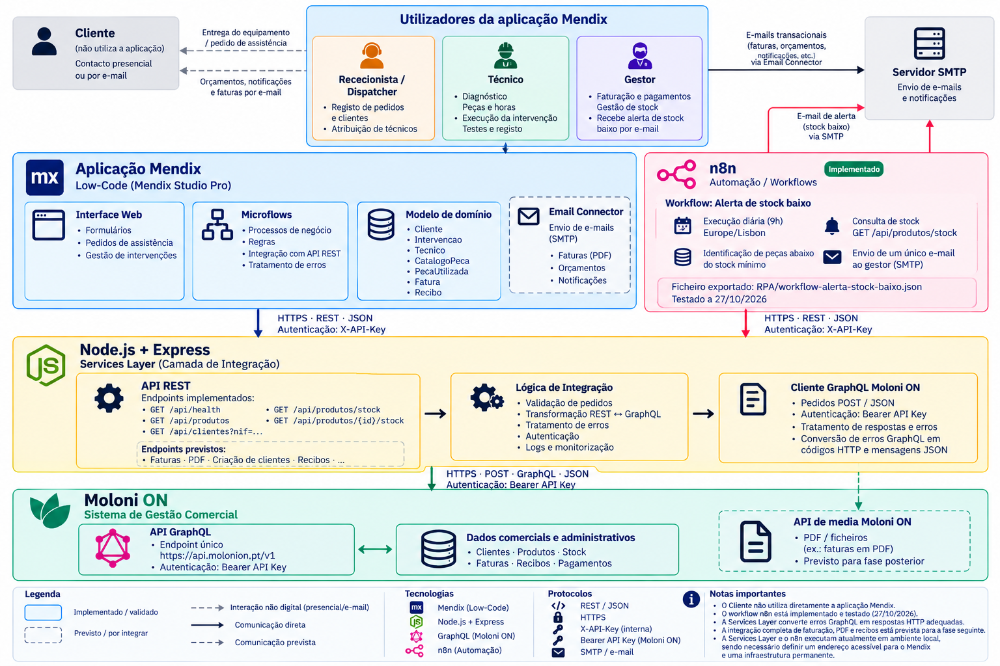

**2.1. Arquitetura da Solução**

A arquitetura proposta para o sistema de Gestão Inteligente de Assistência Técnica e Intervenções assenta numa abordagem modular, integrando diferentes tecnologias de acordo com as responsabilidades de cada componente.

A solução combina a plataforma *Low-Code* Mendix, responsável pela gestão dos processos de assistência técnica, uma camada intermédia de serviços desenvolvida em Node.js e Express, o ERP Moloni ON para a gestão comercial e administrativa e a ferramenta n8n para a automatização de tarefas periódicas.

A **Figura 1** apresenta a arquitetura lógica da solução, identificando os principais componentes, as respetivas responsabilidades e os mecanismos de comunicação.

**Figura 1 — Arquitetura lógica da solução integrada de gestão de assistência técnica**

**Plataforma Mendix**

O Mendix constitui a plataforma central de gestão dos processos de assistência técnica, abrangendo as oito etapas do processo de negócio descritas na Secção 2.2, desde a receção do pedido até ao pagamento e à entrega do equipamento.

A aplicação web é desenvolvida no Mendix Studio Pro, recorrendo ao *Team Server* para apoiar o trabalho colaborativo dos elementos do grupo.

A utilização da aplicação está organizada em três perfis principais:

**Rececionista/Dispatcher:** responsável pelo registo inicial dos pedidos e clientes, pela organização das intervenções e pela atribuição de técnicos.

**Técnico:** responsável pelo diagnóstico, elaboração de orçamentos, identificação das peças necessárias, registo das horas de trabalho e realização de testes.

**Gestor:** responsável pelo acompanhamento das intervenções, faturação, pagamentos e gestão das necessidades de reposição de stock.

O Cliente é um interveniente externo e não utiliza diretamente a aplicação Mendix, estabelecendo contacto com a empresa presencialmente ou através de correio eletrónico.

O modelo de domínio da aplicação contempla as entidades Cliente, Intervencao, Tecnico, CatalogoPeca, PecaUtilizada, Fatura e Recibo.

A entidade Intervencao representa o próprio pedido de assistência, acompanhando o processo desde o registo inicial até à sua conclusão, sem necessidade de uma entidade Pedido independente.

Os processos e regras de negócio são implementados através de *microflows*, permitindo coordenar as diferentes etapas e comunicar com os serviços externos.

Para consumir a Services Layer, o Mendix utiliza o contrato services-layer/openapi.yaml como referência para a configuração de serviços REST. As operações são invocadas através de ações *Call REST Service*, utilizando o cabeçalho X-API-Key para autenticação.

As respostas JSON são transformadas através de *import mappings* e entidades não persistentes, sendo posteriormente transferidos para as entidades persistentes os dados relevantes e as referências aos registos do ERP, como MoloniCustomerId, MoloniProductId, MoloniDocumentId e MoloniReceiptId.

Nesta fase, o modelo de domínio encontra-se desenvolvido e os microflows estão em construção, permanecendo por validar a integração completa entre a aplicação Mendix e a Services Layer.

**Camada de integração — Services Layer**

Entre o Mendix e o Moloni ON foi desenvolvida uma camada intermédia de integração, utilizando Node.js, JavaScript e Express.

Esta componente disponibiliza uma API REST responsável por receber pedidos dos sistemas consumidores, validar parâmetros e credenciais, executar operações sobre a API GraphQL do Moloni ON e transformar os resultados em respostas JSON.

A Services Layer centraliza os mecanismos de autenticação e tratamento de erros, evitando que o Mendix e o n8n tenham de implementar diretamente as operações GraphQL do ERP.

Na fase atual, encontram-se implementados e testados cinco endpoints REST:

|  |  |  |
|:--:|----|----|
| **Método** | **Endpoint** | **Funcionalidade** |
| GET | /api/health | Verificação do estado da Services Layer |
| GET | /api/produtos | Consulta dos produtos existentes no ERP |
| GET | /api/clientes?nif=... | Pesquisa de clientes através do NIF |
| GET | /api/produtos/stock | Consulta dos produtos com controlo de stock |
| GET | /api/produtos/{id}/stock | Consulta do stock de um produto específico |

Foi igualmente realizada uma prova de conceito de faturação, através de scripts de teste que permitiram criar e consultar uma fatura em rascunho no Moloni ON.

A disponibilização de endpoints REST para operações de faturação, criação de clientes e registo de recibos está prevista para uma fase posterior de desenvolvimento.

A utilização desta camada intermédia promove a separação de responsabilidades, a reutilização dos serviços e a evolução independente dos diferentes componentes tecnológicos.

**ERP Moloni ON**

O Moloni ON desempenha o papel de sistema de gestão comercial e administrativa, centralizando informações relativas a clientes, produtos, existências em armazém, documentos de faturação e pagamentos.

A comunicação com o ERP é realizada através da sua API GraphQL, utilizando pedidos HTTPS POST ao endereço https://api.molonion.pt/v1 e autenticação por API Key no cabeçalho Authorization, através do esquema *Bearer*.

As operações de consulta e atualização são efetuadas através de *queries* e *mutations*, respetivamente.

Para além da API GraphQL, a arquitetura contempla a utilização da API de media do Moloni ON para a recuperação de documentos comerciais em formato PDF, nomeadamente faturas. Embora este processo já tenha sido explorado na componente ERP, a sua integração na Services Layer encontra-se prevista para uma fase posterior.

O ERP constitui o sistema de referência para os dados comerciais, enquanto a informação operacional relativa aos pedidos, técnicos e intervenções é gerida no Mendix.

Durante a análise tecnológica, foi também considerada a plataforma Jasmin como alternativa de ERP. Contudo, a arquitetura adotada utiliza o Moloni ON, não tendo sido desenvolvida uma integração com o Jasmin.

**Automação com n8n**

A solução integra a ferramenta n8n, executada em ambiente local (*self-hosted*), como componente responsável pela automatização da monitorização de existências.

O workflow **«Alerta de stock baixo»** encontra-se implementado e testado. A sua execução está agendada diariamente para as 9h, através do nó *Schedule Trigger*, utilizando o fuso horário Europe/Lisbon.

O workflow consulta o endpoint REST GET /api/produtos/stock da Services Layer, autenticando-se através do cabeçalho X-API-Key.

Os produtos cujo stock atual se encontra abaixo do mínimo configurado são identificados e agrupados num único alerta, enviado por correio eletrónico ao Gestor através de SMTP.

Foram realizados testes com dados reais do Moloni ON, tendo sido validados a identificação das peças abaixo do mínimo, o envio do e-mail e a execução automática por agendamento, a 27 de outubro de 2026.

O workflow foi igualmente exportado para o ficheiro RPA/workflow-alerta-stock-baixo.json, permitindo a sua reutilização e configuração noutra instância do n8n.

A execução atual depende da disponibilidade dos serviços instalados localmente. Para assegurar o funcionamento contínuo, será necessário disponibilizar a solução num ambiente permanentemente acessível.

**Comunicação e segurança**

A arquitetura prevê a utilização de HTTPS nas comunicações entre os diferentes sistemas em ambientes acessíveis por rede.

O Mendix e o n8n utilizam uma interface REST para comunicar com a Services Layer, com troca de dados em formato JSON e autenticação através de uma chave interna transmitida no cabeçalho X-API-Key.

Por sua vez, a Services Layer utiliza a autenticação própria do Moloni ON para executar operações GraphQL.

Esta separação permite centralizar as credenciais do ERP na camada de integração e evitar a sua exposição direta aos restantes componentes.

A Services Layer encontra-se preparada para validar os pedidos recebidos e tratar erros de comunicação com o ERP. Está prevista a melhoria do tratamento de erros de autenticação e de operação devolvidos pelo Moloni ON, permitindo que o Mendix receba códigos HTTP e mensagens JSON adequados.

A arquitetura contempla também dois mecanismos de envio de correio eletrónico.

O workflow n8n utiliza SMTP para enviar os alertas de stock baixo ao Gestor, funcionalidade já implementada e testada.

Por sua vez, o Mendix prevê utilizar o módulo *Email Connector*, também através de SMTP, para enviar notificações e documentos associados aos processos de assistência técnica, incluindo faturas em PDF.

Atualmente, a Services Layer encontra-se em ambiente local de desenvolvimento. A definição de um endereço acessível ao Mendix e de uma infraestrutura adequada à execução contínua da solução permanece por concluir.

**Síntese da arquitetura**

A arquitetura definida assegura a separação de responsabilidades entre os diferentes sistemas e estabelece uma base tecnológica para a integração progressiva dos processos de assistência técnica.

O Mendix concentra a gestão operacional e a interação com os utilizadores; a Services Layer centraliza a comunicação e transformação dos dados; o Moloni ON disponibiliza as funcionalidades comerciais e administrativas; e o n8n executa a automatização dos alertas de stock.

Nesta fase, encontram-se validadas a comunicação entre a Services Layer e o Moloni ON, as operações REST de consulta, a prova de conceito de faturação e a automatização de alertas com n8n.

A integração completa com os microflows do Mendix e a disponibilização dos restantes endpoints REST constituem atividades previstas para as fases seguintes do projeto.
