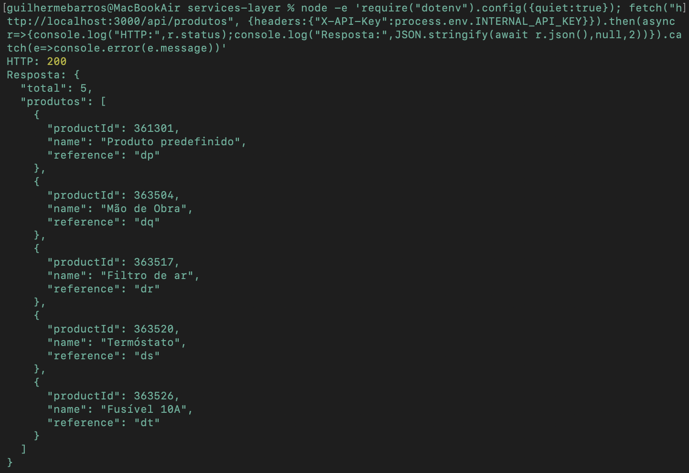
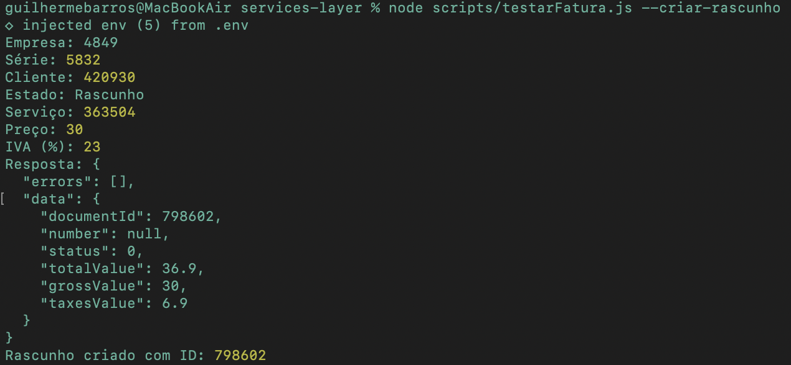
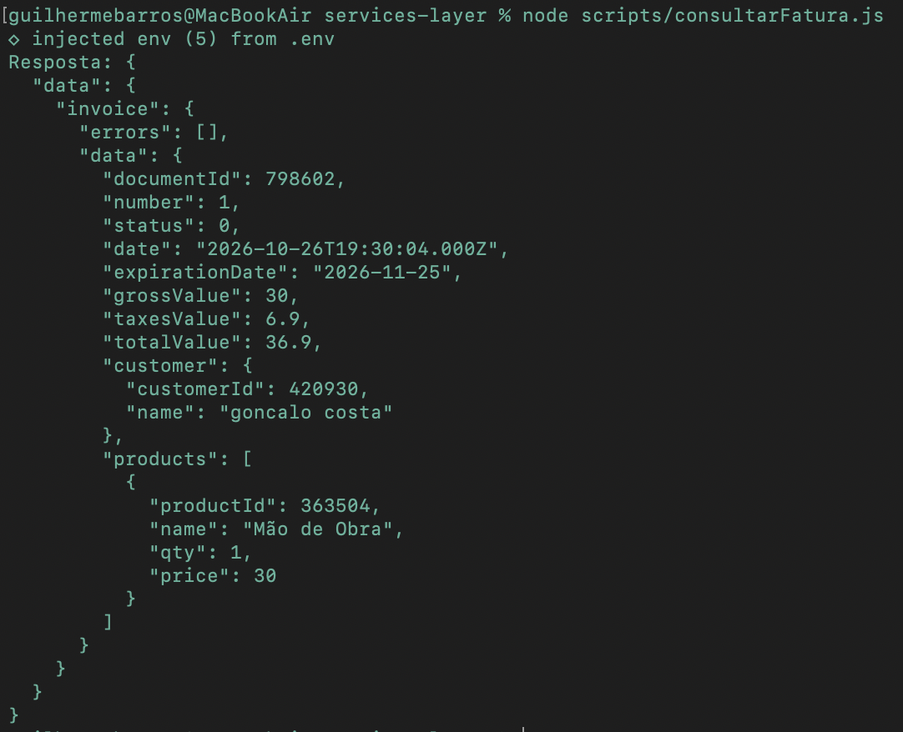

**4.1. Integração com o ERP Moloni ON**

**4.1.1. Objetivo da integração**

A integração com o ERP Moloni ON tem como principal objetivo permitir a comunicação entre a aplicação de gestão de assistência técnica, desenvolvida na plataforma Mendix, e o sistema responsável pela gestão dos dados comerciais e administrativos da empresa.

No âmbito do projeto, o Moloni ON é utilizado para centralizar informação relativa a clientes, produtos, existências em armazém e documentos de faturação. A integração permite que a aplicação de assistência técnica consulte e utilize estes dados sem necessidade de os manter duplicados em diferentes sistemas.

Para concretizar esta comunicação, foi desenvolvida uma camada intermédia de serviços (*Services Layer*), responsável por receber pedidos REST, estabelecer comunicação com a API GraphQL do Moloni ON e devolver respostas JSON adaptadas às necessidades dos restantes componentes da solução.

Esta abordagem promove a separação de responsabilidades entre os sistemas, reduz o acoplamento tecnológico e facilita a manutenção e evolução da solução.

**4.1.2. Arquitetura e tecnologias utilizadas**

A camada de integração foi desenvolvida utilizando Node.js, JavaScript e o framework Express, permitindo disponibilizar uma API REST para consumo por aplicações externas.

A comunicação entre os componentes segue o seguinte modelo:

**Mendix:** aplicação responsável pela interface com os utilizadores e pela gestão dos processos de assistência técnica;

**Services Layer:** componente intermédio responsável pela disponibilização de endpoints REST, autenticação, validação de pedidos e transformação de dados;

**Moloni ON:** sistema ERP que disponibiliza operações de consulta e gestão de informação através de uma API GraphQL;

**n8n:** ferramenta de automação utilizada para monitorizar diariamente os níveis de stock das peças e enviar alertas por correio eletrónico ao gestor. O workflow encontra-se implementado e foi testado com dados reais obtidos através da Services Layer.

A comunicação com o Moloni ON é realizada através de pedidos HTTP POST ao endpoint https://api.molonion.pt/v1, com operações GraphQL e respostas no formato JSON.

A arquitetura permite que os consumidores da Services Layer utilizem uma interface REST, sem necessitarem de conhecer diretamente a estrutura GraphQL do ERP.

**Análise da abordagem de integração**

Para a integração com o Moloni ON, foi considerada a possibilidade de recorrer diretamente à sua API GraphQL ou de desenvolver uma camada intermédia que disponibilizasse serviços REST aos restantes componentes.

Durante o estudo das alternativas de integração, foram identificadas ferramentas compatíveis com a API GraphQL do Moloni ON, incluindo Postman, Insomnia e mecanismos de geração automática de código a partir do esquema GraphQL disponibilizado oficialmente.

Estas ferramentas facilitam a exploração, a documentação e o desenvolvimento de clientes para a API, mas não dispensam necessariamente a implementação de uma camada intermédia que disponibilize os endpoints REST específicos exigidos pela aplicação Mendix.

Na documentação oficial consultada não foi identificada uma Services Layer REST pronta a utilizar que correspondesse ao contrato definido para este projeto. Por esse motivo, optou-se pelo desenvolvimento de uma camada própria, utilizando Node.js e Express, permitindo controlar as operações disponibilizadas, a autenticação, a transformação dos dados e o tratamento de erros.

Optou-se pela implementação de uma Services Layer própria, utilizando Node.js e Express, permitindo centralizar a autenticação, a validação dos pedidos, a transformação dos dados e o tratamento de erros. Esta abordagem permite ainda disponibilizar um contrato OpenAPI comum ao Mendix e ao n8n, sem exigir que estes componentes implementem diretamente as operações GraphQL do ERP.

A solução desenvolvida favorece a reutilização dos serviços e a evolução independente dos componentes, embora implique a manutenção de uma aplicação adicional.

**4.1.3. Segurança e autenticação**

A solução implementa dois mecanismos distintos de autenticação, correspondentes às diferentes ligações entre sistemas.

Na comunicação entre a Services Layer e o Moloni ON é utilizada uma API Key fornecida pelo ERP, transmitida no cabeçalho HTTP Authorization, com o esquema Bearer.

Por sua vez, os consumidores da Services Layer devem apresentar uma chave interna através do cabeçalho X-API-Key.

Esta separação evita a necessidade de disponibilizar diretamente as credenciais do ERP aos sistemas consumidores.

As credenciais são armazenadas em variáveis de ambiente, através de um ficheiro .env, excluído do controlo de versões. O repositório disponibiliza um ficheiro .env.example, contendo apenas os nomes das variáveis necessárias à configuração do ambiente.

Foi implementado um middleware de autenticação que verifica a presença e validade da chave interna antes de permitir o acesso aos endpoints de negócio. A comparação das credenciais utiliza funções criptográficas disponibilizadas pelo Node.js.

Nos testes efetuados, foram confirmadas respostas HTTP 401 para pedidos sem credencial, HTTP 403 para credenciais inválidas e HTTP 200 para pedidos corretamente autenticados.

Foi igualmente implementado um mecanismo centralizado de classificação e tratamento de erros provenientes do Moloni ON. Este mecanismo identifica falhas de autenticação, validação, comunicação e operação, incluindo erros GraphQL devolvidos no corpo de respostas HTTP 200.

A Services Layer transforma estes erros em respostas REST com códigos HTTP e mensagens JSON estruturadas, incluindo identificadores como MOLONI_AUTENTICACAO e MOLONI_VALIDACAO. Desta forma, os consumidores da API podem distinguir diferentes situações de falha sem receber diretamente as mensagens técnicas do ERP.

O comportamento foi validado através de testes simulados de autenticação e validação, bem como de testes independentes do módulo responsável pela construção das respostas JSON. A validação integral destes cenários através de pedidos HTTP reais à aplicação Express permanece como atividade complementar.

**4.1.4. Endpoints REST implementados**

Na primeira fase de desenvolvimento, foram implementados cinco endpoints REST, permitindo demonstrar a comunicação entre a Services Layer e o Moloni ON.

| **Método** | **Endpoint** | **Funcionalidade** |
|---|---|---|
| GET | /api/health | Verificação do estado do servidor |
| GET | /api/produtos | Consulta do catálogo de produtos |
| GET | /api/clientes?nif=... | Pesquisa de clientes através do NIF |
| GET | /api/produtos/stock | Consulta do stock dos produtos sujeitos a controlo de existências |
| GET | /api/produtos/{id}/stock | Consulta do stock de um produto específico |

O endpoint de verificação do servidor é público, enquanto os restantes estão protegidos através da autenticação interna.

A consulta de produtos utiliza a operação GraphQL products, devolvendo os identificadores, nomes e referências dos artigos existentes no ERP.

A pesquisa de clientes utiliza a operação customers, permitindo filtrar os resultados pelo campo vat, correspondente ao NIF. Esta funcionalidade é relevante para identificar clientes previamente registados no ERP durante o processo de assistência técnica.

Relativamente ao stock, foram implementadas consultas individuais e gerais. A consulta geral devolve apenas os artigos que possuem controlo de stock ativo, incluindo as quantidades atuais e os valores mínimos configurados.

Esta informação é utilizada pelo workflow n8n desenvolvido no âmbito do projeto, que consulta diariamente o endpoint GET /api/produtos/stock, identifica os produtos cujas existências são inferiores ao stock mínimo configurado e envia um alerta consolidado por correio eletrónico ao gestor. A integração foi testada com dados reais do Moloni ON, tendo sido também validada a execução automática por agendamento.

**Correspondência entre as operações GraphQL e a Services Layer**

Na análise funcional do ERP foram identificadas 19 operações GraphQL relevantes para o processo de assistência técnica. A tabela seguinte apresenta o estado de cobertura destas operações pela Services Layer, distinguindo as funcionalidades já disponibilizadas através de endpoints REST, as validadas através de scripts de teste e as previstas para fases posteriores.

| **Operação GraphQL** | **Estado na integração** |
|---|---|
| me | Validada através de script |
| documentSetsForDocument | Validada através de script |
| paymentMethods | Prevista |
| taxes | Validada através de script |
| measurementUnits | Prevista |
| productCategories | Prevista |
| countries | Prevista |
| productCreate | Prevista |
| customers | Implementada em GET /api/clientes |
| customerNextNumber | Prevista |
| customerCreate | Prevista |
| products | Implementada em GET /api/produtos e GET /api/produtos/stock |
| product | Implementada em GET /api/produtos/{id}/stock |
| invoiceCreate | Validada através de script |
| invoiceGetPDF | Prevista na Services Layer |
| invoiceGetPDFToken | Prevista na Services Layer |
| receiptCreate | Prevista |
| invoice | Validada através de script |
| getCustomerRelatedDocuments | Prevista |

Das 19 operações GraphQL identificadas, três (customers, products e product) são utilizadas pelos endpoints REST atualmente implementados. Estas operações suportam quatro endpoints de consulta, aos quais se junta o endpoint /api/health, perfazendo cinco endpoints REST. Adicionalmente, cinco operações GraphQL foram identificadas na análise como validadas através de scripts de teste.

Destaca-se a validação das operações invoiceCreate e invoice, que permitiu criar e consultar uma fatura em rascunho no Moloni ON, confirmando a viabilidade das operações de escrita e leitura de documentos comerciais.

As restantes operações integram o âmbito funcional previsto para fases posteriores. Algumas já foram exploradas diretamente no ERP pelo elemento responsável por essa componente, mas ainda não se encontram integradas na Services Layer.

Esta implementação incremental permite disponibilizar inicialmente as funcionalidades prioritárias e alargar posteriormente a integração, de acordo com as necessidades do processo de negócio.

**4.1.5. Documentação e contrato OpenAPI**

Para facilitar a integração com os restantes componentes, foi elaborado um contrato de API utilizando a especificação OpenAPI 3.0.3.

O contrato encontra-se definido no ficheiro services-layer/openapi.yaml, disponibilizado no repositório GitHub partilhado pelo grupo.

Este documento identifica os endpoints REST, os parâmetros necessários, os mecanismos de autenticação, as estruturas JSON e os códigos de resposta HTTP.

A documentação foi validada através da ferramenta Redocly CLI, tendo sido confirmada a validade estrutural da especificação OpenAPI.

O contrato poderá ser utilizado pela equipa responsável pelo Mendix para configurar o consumo dos serviços REST, bem como pela componente n8n para identificar as operações disponíveis.

A importação e o consumo efetivo da API por estes componentes constituem atividades de integração entre os elementos do grupo.

**4.1.6. Prova de conceito e testes realizados**

A prova de conceito foi realizada utilizando uma empresa de testes previamente configurada no Moloni ON.

Inicialmente, foi validada a autenticação através da operação GraphQL me, confirmando a identificação do utilizador autenticado e o acesso à empresa pretendida.

Posteriormente, foram executadas consultas de produtos, clientes e stock, verificando a correspondência entre os dados disponibilizados pelo ERP e os resultados apresentados pelos endpoints REST.

Figura 1 — Consulta autenticada de produtos através da API REST da Services Layer.

Na consulta de produtos foram identificados cinco registos, dos quais três possuíam controlo de stock ativo. A pesquisa de clientes por NIF foi também validada, incluindo os cenários de cliente existente, cliente inexistente e ausência do parâmetro obrigatório.

Foram realizados testes de tratamento de erros, incluindo identificadores de produto inválidos, produtos inexistentes e falhas de comunicação com o ERP.

Para simular a indisponibilidade do Moloni ON, foi executada uma instância temporária da Services Layer com um endereço de API inacessível. O sistema identificou a falha de comunicação e devolveu uma resposta HTTP 502, sem interromper o funcionamento do servidor.

Adicionalmente, foi realizada uma prova de conceito de faturação através da operação GraphQL invoiceCreate.

Foi criada uma fatura em estado de rascunho (status: 0), associada a um cliente de testes e contendo uma linha correspondente ao serviço de Mão de Obra.

Figura 2 — Criação de uma fatura em rascunho através da operação GraphQL invoiceCreate.

Após a criação, foi executada uma consulta independente através da operação GraphQL invoice, que confirmou a persistência do documento no ERP, o respetivo estado, os dados do cliente e os valores calculados.

Durante a exploração da faturação foram identificadas três particularidades relevantes para a integração. Em primeiro lugar, foi necessário indicar explicitamente o IVA em cada linha do documento, uma vez que os impostos associados aos produtos não garantiam a aplicação da taxa pretendida na fatura. Esta situação foi validada através da criação de um rascunho com IVA de 23%.

Em segundo lugar, os testes realizados no Moloni ON demonstraram que a criação de uma fatura em rascunho não provoca a redução das existências em armazém. A redução de stock associada à finalização de uma fatura permanece por confirmar através de um teste específico.

Por último, verificou-se que os documentos em rascunho também são contabilizados no limite de 50 documentos mensais do plano de testes, pelo que se deve evitar a criação repetida de documentos durante a exploração da API.

Figura 3 — Consulta da fatura 798602, confirmando o estado de rascunho e o total de 36,90 €.

Esta experiência demonstrou a viabilidade de operações de escrita no Moloni ON. Nesta fase, a criação e consulta de faturas foram realizadas através de scripts de teste, não estando ainda disponibilizadas como endpoints REST da Services Layer.

**4.1.7. Limitações e evolução prevista**

Apesar dos resultados obtidos, a integração encontra-se numa fase de prova de conceito.

Os principais desenvolvimentos previstos incluem a disponibilização de endpoints REST para criação e consulta de documentos de faturação, a recuperação de documentos PDF e a integração efetiva com os processos implementados no Mendix. O workflow de alerta de stock no n8n já foi implementado e testado, incluindo o envio de notificações e a execução automática agendada. Contudo, a sua execução atual depende da disponibilidade dos serviços instalados localmente, sendo necessário definir uma infraestrutura permanentemente acessível para utilização contínua.

Será igualmente necessário definir uma forma de disponibilização da Services Layer que permita o acesso pelos restantes sistemas no ambiente de execução adotado.

A integração completa deverá ainda contemplar outras operações comerciais e administrativas relevantes para o processo de assistência técnica, como o registo de pagamentos e a atualização de existências associada à faturação.

**4.1.8. Síntese**

A prova de conceito desenvolvida demonstrou a viabilidade técnica da integração entre uma aplicação externa e o ERP Moloni ON, através de uma camada intermédia baseada em Node.js e Express.

Foram validadas operações GraphQL de leitura e escrita, mecanismos de autenticação, transformação de respostas JSON, tratamento de erros e documentação formal da API.

Os resultados constituem uma base funcional para a evolução da solução integrada de gestão de assistência técnica, encontrando-se já validada a comunicação com o Moloni ON e a utilização da Services Layer pelo workflow n8n de alerta de stock baixo. A integração completa com a aplicação Mendix e o alargamento das operações de faturação constituem as principais atividades previstas para as fases seguintes.
